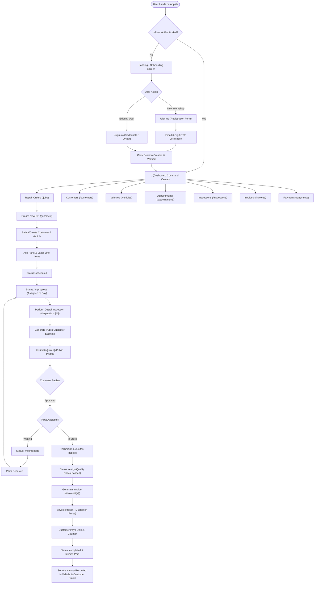
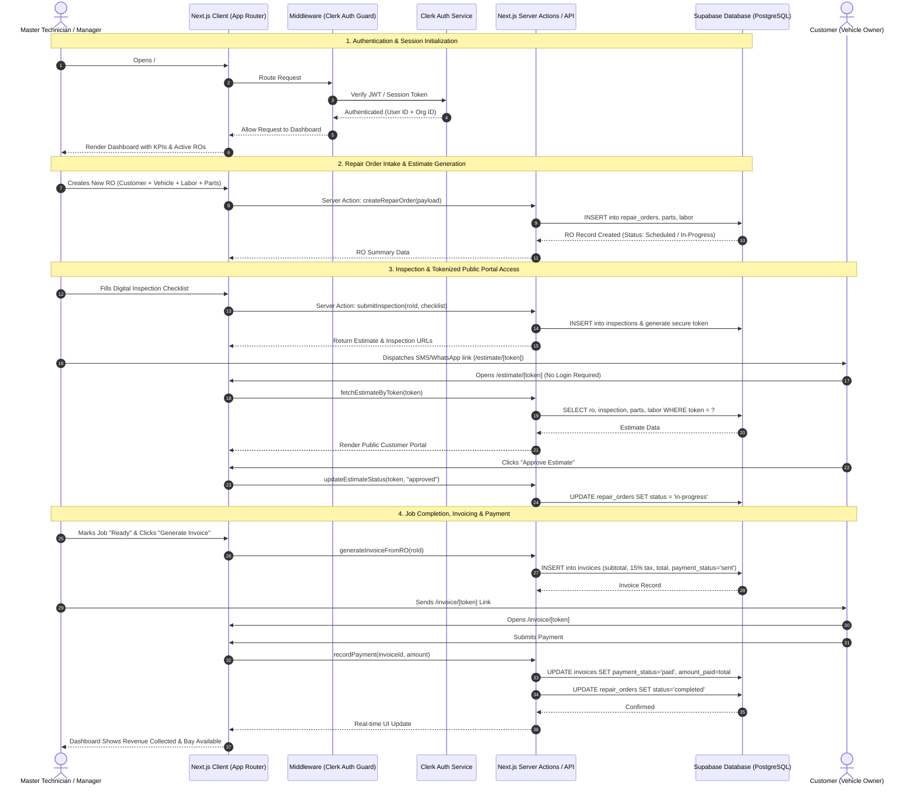
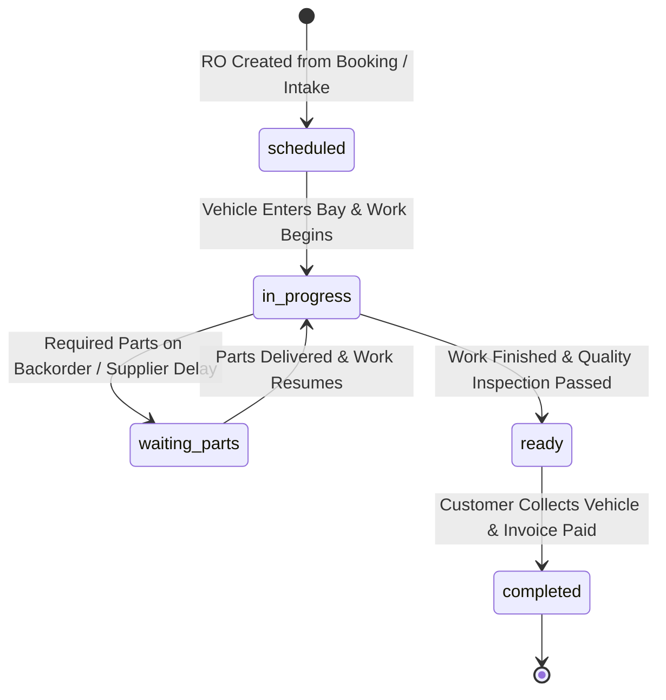
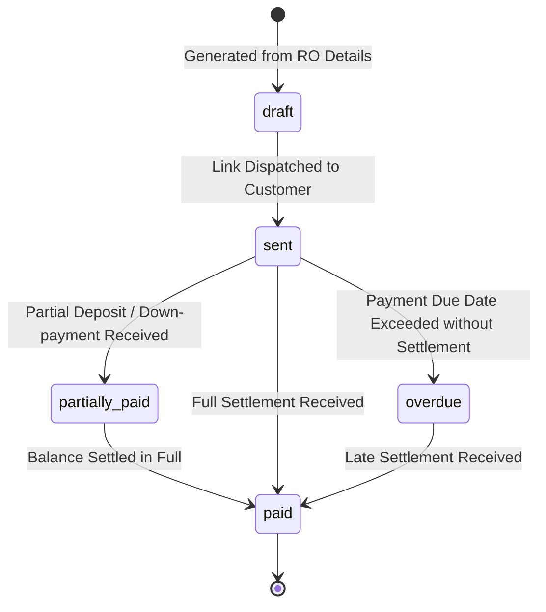

# MechanicMate — Complete App Flow, Systems Logic & Architecture

> **Generated:** 2026-09-19  
> **Stack:** Next.js 15 (App Router) · Clerk Auth · Supabase (PostgreSQL) · Tailwind CSS · Vercel  
> **Repo:** `c:\Users\Elihu Joseph Mvura\Documents\mech`

---

## 1. Visual Flowcharts & Diagrams

### 1.1 Master End-to-End Application Flowchart



---

### 1.2 System Sequence Diagram (Multi-Actor Interaction)



---

### 1.3 State Machine Diagrams

#### Repair Order State Transitions


#### Invoice Payment State Transitions


---

## 2. Systems Logic & Technical Rules Engine

This section explicitly defines the underlying business rules, calculations, algorithms, and security policies governing MechanicMate.

---

### 2.1 Financial & Calculation Engine

All prices are stored and calculated in standard decimal floating point format with 2 decimal places precision.

#### 1. Parts Total Calculation
For any given Repair Order $RO$:
$$\text{PartsTotal} = \sum_{i=1}^{n} (\text{quantity}_i \times \text{unitPrice}_i)$$
- **Rule:** If quantity $\le 0$ or unit price $< 0$, input validation rejects the line item before calculation.

#### 2. Labor Total Calculation
$$\text{LaborTotal} = \sum_{j=1}^{m} (\text{hours}_j \times \text{hourlyRate}_j)$$
- **Rule:** If $\text{hourlyRate}_j$ is not specified per task, it inherits the workshop default ($\text{R}480.00/\text{hr}$).

#### 3. Subtotal, Tax & Total Calculation
$$\text{Subtotal} = \text{PartsTotal} + \text{LaborTotal}$$
$$\text{TaxAmount} = \text{Subtotal} \times \left( \frac{\text{taxRatePercent}}{100} \right)$$
$$\text{EstimateTotal} = \text{Subtotal} + \text{TaxAmount}$$
- **Rule:** Default $\text{taxRatePercent} = 15.0\%$ (South African VAT / Standard Sales Tax).
- **Rule:** Invoices inherit this exact breakdown at the moment of invoice generation. Once an invoice is issued, line item prices are immutable snapshots.

---

### 2.2 Payment Reconciliation & Status Progression Logic

The financial ledger determines an invoice's state automatically through delta calculation:

$$\text{BalanceDue} = \text{Total} - \text{AmountPaid}$$

| Condition | Assigned `paymentStatus` | System Action |
|---|---|---|
| $\text{AmountPaid} = 0$ and not dispatched | `draft` | Stored internally, not visible in portal |
| $\text{AmountPaid} = 0$ and dispatched | `sent` | Link active in customer portal |
| $0 < \text{AmountPaid} < \text{Total}$ | `partially-paid` | Records partial payment receipt |
| $\text{AmountPaid} \ge \text{Total}$ | `paid` | Closes invoice, updates customer balance |
| $\text{CurrentDate} > \text{DueDate}$ and $\text{AmountPaid} < \text{Total}$ | `overdue` | Flags in dashboard receivable alert |

- **Customer Balance Aggregation Rule:**
$$\text{CustomerOutstandingBalance} = \sum \text{BalanceDue of all unpaid invoices for that Customer}$$

---

### 2.3 Multi-Tenancy & Authorization Security Logic

MechanicMate enforces strict data isolation using **Organization-Scoped Multi-Tenancy**:

1. **Tenant Segregation:**
   - Every workshop is assigned a unique `workshopId` (synced with Clerk `org_id`).
   - Every database query for customers, vehicles, repair orders, and invoices includes a mandatory filter:
     `WHERE workshop_id = current_user_workshop_id`.
   - Cross-tenant data access is blocked at the database row-level security (RLS) and middleware level.

2. **Role-Based Access Control (RBAC):**
   - **Owner / Workshop Manager:** Full access (financial reports, employee rates, workshop settings, tax configuration).
   - **Lead Master Technician:** Create/edit ROs, assign bays, approve digital inspections, create invoices.
   - **Apprentice / Bay Technician:** View assigned jobs, complete inspection checklists, clock labor hours.
   - **Customer (Vehicle Owner):** Read-only portal access strictly scoped to their single tokenized document.

---

### 2.4 Digital Vehicle Inspection (DVI) & Severity Scoring Logic

Inspections consist of items categorized into 6 vehicle subsystems:
- **Brakes** (pads, rotors, calipers, fluid lines)
- **Tires & Wheels** (tread depth, pressure, alignment, wheel bearings)
- **Under Hood & Fluids** (engine oil, coolant, transmission fluid, belts, filters)
- **Suspension & Steering** (shocks, struts, ball joints, tie rods)
- **Electrical & Battery** (battery health, starter, alternator, diagnostics)
- **Exterior & Lighting** (headlights, brake lights, wipers, body integrity)

#### Severity Scoring Rules:
- 🟢 **Good (Pass):** Component is operating within manufacturer specifications.
- 🟡 **Attention (Caution):** Component is showing wear (e.g. brake pad at 3mm). Recommended for service in next 3,000–5,000 km.
- 🔴 **Urgent (Fail/Safety Risk):** Component is degraded or unsafe (e.g. tire cord exposed, brake line leak). Immediate repair required.

#### Inspection-to-Quote Automatic Conversion:
- When an inspection item is flagged 🟡 or 🔴, the system provides a 1-click **"Add to Estimate"** action.
- This creates a recommended part and labor item in the Repair Order draft with notes copied from the inspection report.

---

### 2.5 Public Customer Portal Tokenization & Auth-Bypass Logic

To allow friction-free customer access without requiring vehicle owners to create an account, MechanicMate uses **Tokenized URLs**:

```
https://mechanicmate.app/estimate/est_9a8f2c3d4e5b6a71
https://mechanicmate.app/invoice/inv_7b6a5c4d3e2f1a89
```

#### Security Implementation Rules:
1. **Token Entropy:** Generated using 256-bit cryptographically secure pseudorandom identifiers.
2. **Middleware Exemption:** Routes matching `/(estimate|invoice|inspection)/.*` are explicitly exempt from Clerk authentication checks.
3. **Scoped Payload Resolution:** The API resolver looks up the database record exclusively by matching `WHERE access_token = ?`.
4. **Action Authorization:**
   - Customers can trigger state mutations only on authorized endpoints (e.g. `POST /api/portal/estimate/approve`).
   - Customers cannot alter line-item quantities or pricing; approvals are cryptographic all-or-nothing or itemized selection.

---

### 2.6 Workshop Bay Capacity & Appointment Scheduling Logic

1. **Bay Allocation:**
   - Workshops define $N$ active bays (e.g. Bay 1 — Lift, Bay 2 — Alignment, Bay 3 — Quick Lube).
   - When an appointment is scheduled, it reserves a `bayNumber` and `timeSlot`.
2. **Collision Prevention:**
   - Overlapping bookings for the same bay during the same time window are rejected with a scheduling conflict warning.
3. **State Linkage:**
   - Changing an Appointment to **"In Bay"** automatically triggers the associated Repair Order status to transition to **`in-progress`**.

---

### 2.7 VIN Scanner & Decoding Logic

1. **Input Pipeline:**
   - Camera OCR capture / Barcode scanner / Manual 17-character input.
2. **ISO 3779 Checksum Verification:**
   - Validates the 9th character check digit against the weighted modulus-11 algorithm:
     $$\text{CheckDigit} = \left( \sum_{k=1}^{17} \text{Weight}_k \times \text{TransliteratedValue}_k \right) \bmod 11$$
3. **Decomposition:**
   - Characters 1–3: **WMI** (World Manufacturer Identifier) $\rightarrow$ Country & Make.
   - Characters 4–8: **VDS** (Vehicle Descriptor Section) $\rightarrow$ Model, Body type, Engine type.
   - Character 10: **Model Year** code.
   - Characters 11–17: **VIS** (Vehicle Identifier Section) $\rightarrow$ Assembly plant & Serial number.

---

## 3. Architecture Overview

The app is divided into **three route groups** (Next.js parallel layouts) plus a **root layout** that wraps everything.

```
app/
├── layout.tsx              ← Root layout: ClerkProvider + fonts + globals
├── (auth)/                 ← Public auth pages — centered card layout
│   ├── sign-in/
│   ├── sign-up/
│   ├── verify-email/
│   └── sso-callback/
├── (dashboard)/            ← Protected workshop pages — AppShell layout
│   ├── page.tsx            ← / (dashboard home)
│   ├── dashboard/
│   ├── jobs/
│   ├── customers/
│   ├── vehicles/
│   ├── appointments/
│   ├── inspections/
│   ├── invoices/
│   ├── payments/
│   ├── reports/
│   ├── tasks/
│   └── settings/
└── (portal)/               ← Public customer-facing pages — minimal layout
    ├── estimate/[token]/
    ├── invoice/[token]/
    └── inspection/[id]/
```

---

## 4. Entry Point & Auth Gate

### Stage 1 — Root Layout (`app/layout.tsx`)
Every request first hits the root layout. It does two things:

1. **Checks if Clerk is configured** — reads `NEXT_PUBLIC_CLERK_PUBLISHABLE_KEY`. If the key starts with `pk_`, it wraps the app in `<ClerkProvider>`.
2. **If no key is found** — renders without Clerk, enabling a "Demo Mode" that bypasses all auth (useful for local dev without Clerk).

**Transition to Stage 2:** `ClerkProvider` is now active, setting up Clerk's session context for the entire tree.

---

### Stage 2 — Middleware (`middleware.ts`)
Every incoming request (except static files) passes through Clerk middleware **before** rendering any page.

**Public routes** (allowed without login):
- `/sign-in/*`, `/sign-up/*`, `/verify-email/*`, `/sso-callback/*`
- `/estimate/*`, `/invoice/*`, `/inspection/*` — customer portal
- `/api/webhooks/*`

**Protected routes** (all others):
- Calls `auth.protect()` → if no active session, Clerk **redirects to `/sign-in`** automatically.

**Transition to Stage 3:** If the user has a valid session, the request reaches the page. If not, they go to the auth flow.

---

## 5. Core Module Flows

### Stage 5a — Jobs / Repair Orders (`/jobs`)
**The central entity of the entire app.** A `RepairOrder` links Customer $\rightarrow$ Vehicle $\rightarrow$ Inspection $\rightarrow$ Invoice.

**List view** (`/jobs`):
- Filterable by status: All | In Progress | Waiting Parts | Ready for Pickup | Scheduled | Completed
- Each row shows: RO number, customer, vehicle, service, status badge, estimate total
- Clicking a row $\rightarrow$ `/jobs/[id]`

**Create new RO** (`/jobs/new`):
1. Select customer from dropdown (from mock/Supabase customers list)
2. Select their vehicle (filtered by customer)
3. Fill: service type, concern, diagnosis, appointment time, notes
4. Add parts (name, qty, unit price) — running subtotal computed live
5. Add labour items (description, hours, rate)
6. Tax auto-calculated (default 15%)
7. Submit $\rightarrow$ creates RO $\rightarrow$ redirects to `/jobs` or `/jobs/[id]`

**RO Detail** (`/jobs/[id]`):
- Full repair order view with all parts, labour, totals
- Status progression controls: Scheduled $\rightarrow$ In Progress $\rightarrow$ Waiting Parts $\rightarrow$ Ready $\rightarrow$ Completed
- Links to: create/view Inspection, generate Estimate (portal link), generate Invoice

---

### Stage 5b — Customers (`/customers`)

**List view** (`/customers`):
- Search by name/phone/email
- Cards show: name, vehicle count, last service date, outstanding balance
- Click $\rightarrow$ `/customers/[id]`

**New customer** (`/customers/new`):
- Fields: Name, Phone, Email, Address, Notes
- On save $\rightarrow$ creates Customer record $\rightarrow$ redirects back to list

**Customer detail** (`/customers/[id]`):
- Full profile: contact info, all linked vehicles, complete service history (all ROs), outstanding balance
- Quick actions: New RO for this customer, Add Vehicle

---

### Stage 5c — Vehicles (`/vehicles`)

**List view** (`/vehicles`):
- All vehicles across all customers
- Filter by status: Active | In Shop | Completed
- VIN scanner shortcut $\rightarrow$ `/vehicles/scan-vin`
- Click $\rightarrow$ `/vehicles/[id]`

**VIN Scanner** (`/vehicles/scan-vin`):
- Camera-based VIN scan (or manual entry)
- Auto-populates make/model/year fields

---

### Stage 5d — Appointments (`/appointments`)

**List view** (`/appointments`):
- Day/week view of scheduled appointments
- Each appointment: customer, vehicle, service type, bay number, technician, time slot, status (Confirmed / In Bay / Pending)

**Scheduling:**
- Appointment is created when a new RO with a future date is saved
- Status flows: Pending $\rightarrow$ Confirmed $\rightarrow$ In Bay (when RO moves to "in-progress")

---

### Stage 5e — Inspections (`/inspections`)

**List view** (`/inspections`):
- All vehicle inspections, linked to their RO
- Click $\rightarrow$ `/inspections/[id]`

**Inspection detail** (`/inspections/[id]`):
Categorized checklist with item severity: Good (green) / Attention (amber) / Urgent (red).

---

### Stage 5f — Invoices (`/invoices`)

**List view** (`/invoices`):
- All invoices with payment status badges: Draft | Sent | Partially Paid | Paid | Overdue
- Click $\rightarrow$ `/invoices/[id]`

**Invoice detail** (`/invoices/[id]`):
- Mirrors the RO's parts/labour breakdown
- Fields: invoice number, issue date, due date, subtotal, tax (15%), total, amount paid
- Payment status updates here

---

### Stage 5g — Payments, Reports, Tasks & Settings (`/payments`, `/reports`, `/tasks`, `/settings`)

- **Payments**: Live balance tracking across all customers and individual invoices.
- **Reports**: Weekly/monthly revenue summaries, job completion stats, top services.
- **Tasks**: Technician internal task board (To Do / In Progress / Done).
- **Settings**: Workshop profile, hourly rates, tax rate, and notifications.

---

## 6. Full Route Map

| Route | Auth Required | Description |
|---|---|---|
| `/` | ✅ Yes | Dashboard home (or onboarding if logged out) |
| `/sign-in` | ❌ No | Sign-in page |
| `/sign-up` | ❌ No | Sign-up page |
| `/verify-email` | ❌ No | Email verification step |
| `/sso-callback` | ❌ No | Google OAuth callback handler |
| `/dashboard` | ✅ Yes | Dashboard (alias) |
| `/jobs` | ✅ Yes | Repair orders list |
| `/jobs/new` | ✅ Yes | Create new repair order |
| `/jobs/[id]` | ✅ Yes | Repair order detail |
| `/customers` | ✅ Yes | Customers list |
| `/customers/new` | ✅ Yes | Create new customer |
| `/customers/[id]` | ✅ Yes | Customer profile & history |
| `/vehicles` | ✅ Yes | Vehicles list |
| `/vehicles/scan-vin` | ✅ Yes | VIN scanner |
| `/vehicles/[id]` | ✅ Yes | Vehicle detail |
| `/appointments` | ✅ Yes | Appointments calendar |
| `/inspections` | ✅ Yes | Inspections list |
| `/inspections/[id]` | ✅ Yes | Inspection detail (workshop view) |
| `/invoices` | ✅ Yes | Invoices list |
| `/invoices/[id]` | ✅ Yes | Invoice detail & payment tracking |
| `/payments` | ✅ Yes | Payments overview |
| `/reports` | ✅ Yes | Business reports |
| `/tasks` | ✅ Yes | Internal task board |
| `/settings` | ✅ Yes | Workshop settings |
| `/settings/notifications` | ✅ Yes | Notification preferences |
| `/estimate/[token]` | ❌ No | Customer estimate portal (tokenised) |
| `/invoice/[token]` | ❌ No | Customer invoice portal (tokenised) |
| `/inspection/[id]` | ❌ No | Customer inspection report (public) |
